# Neural Network from Scratch: MNIST, Overfitting, and Distribution Shift

A two-layer neural network built in plain **numpy** (no PyTorch or TensorFlow) to learn how training works, why models overfit, how common fixes behave, and why a model that scores ~98% on a benchmark can fail on real-world input.

This is a learning project. The goal was to understand the mechanics (backpropagation, regularization, the train/validation/test split) and to demonstrate each idea with a plot. The code was written with help from Claude Code, but the additional handwriting experiments and conclusions below are my own.

**Headline results**

| | |
|---|---|
| Network | 784 → 128 (ReLU) → 10 (softmax), 101,770 parameters |
| MNIST test accuracy | 97.6% (baseline), 97.7% (with augmentation) |
| Overfitting demo (500 training images) | 100% train vs 86% validation |
| Accuracy on distorted digits | 57.4% (baseline) → 92.0% (with augmentation) |
| Accuracy on my own handwriting, neat (100 digits) | 97% with MNIST-style preprocessing; with naive preprocessing 71% (baseline) vs 95% (augmented) |
| Accuracy on my own handwriting, deliberately messy (100 digits) | 92% with MNIST-style preprocessing; with naive preprocessing 50% (baseline) vs 87% (augmented) |

---

## Stage 1: The network, built from scratch

Everything lives in [`nn.py`](nn.py):

- **Forward pass:** `X → ReLU(X·W1 + b1) → ·W2 + b2 → softmax → probabilities`
- **Loss:** cross-entropy, the mean of `-log(probability given to the correct class)`. An untrained network scores about `ln(10) ≈ 2.30` (pure guessing); mine started at 2.42 with 7.8% accuracy.
- **Backpropagation:** gradients derived by hand with the chain rule. For softmax + cross-entropy the gradient at the logits is simply `probs − one_hot(y)`.
- **SGD:** mini-batches of 64, update `param ← param − lr · grad`.
- **Initialization:** He init (`randn · sqrt(2 / fan_in)`) so signals neither explode nor vanish; zeros would make every neuron identical.

**Checking backprop.** [`check_gradients.py`](check_gradients.py) compares my analytic gradients with finite differences (nudge a weight by 1e-5 and measure the loss change). The relative error is about 1e-8 for every parameter, so the backward pass is correct. With dropout enabled, the error stays near 1e-7.

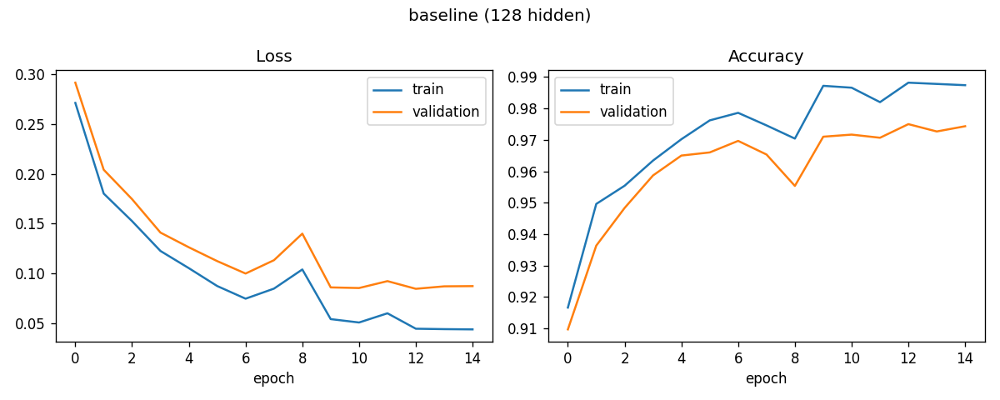

With 50,000 training images, validation accuracy reaches **97.4%** in 15 epochs, and the train and validation curves stay close together. The data was split 50k train / 10k validation / 10k test; the test set was scored once, at the very end.

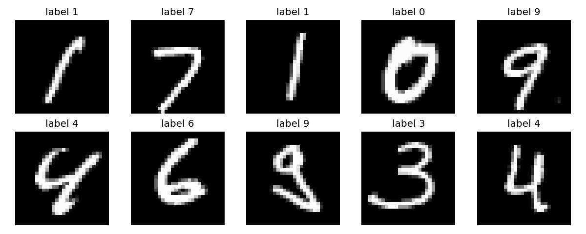

> **Learning points**
> - An image is just a vector of 784 numbers; the network is a function from those numbers to 10 probabilities.
> - Training is repeated "nudge every dial a little in the direction that lowers the loss". Backprop is only the efficient way to compute which direction that is.
> - A gradient check is the standard way to trust hand-written backprop.
> - A positive gradient means "increasing this weight raises the loss", so we step the opposite way.
> - ReLU gates the gradient: neurons that were off for an input get no blame for that input.

---

## Stage 2: Break it on purpose (overfitting)

Setup: a large model (512 hidden neurons, about 400k parameters) trained on only **500 images** for 200 epochs. This is far more parameters than examples.

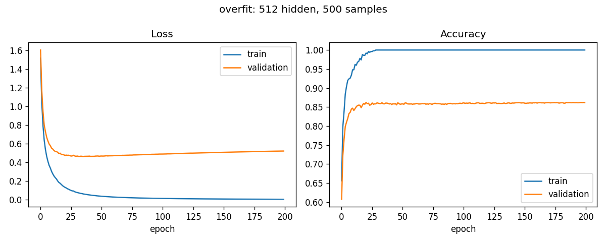

| Epoch | Train acc | Val acc | Val loss |
|---|---|---|---|
| 10 | 94.8% | 85.0% | 0.551 |
| 25 | 99.6% | 85.6% | 0.471 |
| 50 | 100% | 85.9% | 0.464 |
| 100 | 100% | 86.0% | 0.486 |
| 200 | 100% | 86.0% | 0.518 |

- Training loss keeps falling toward zero while **validation loss bottoms out around epoch 36 (0.460) and then rises** to 0.518. That divergence is the signature of overfitting: the model memorizes the 500 images instead of learning what digits look like.
- Validation *accuracy* barely moves after epoch ~25, so the loss shows the problem earlier than accuracy does.

> **Learning points**
> - Overfitting shows up as train metrics improving while validation metrics stall or worsen. You can only see it if you hold out data.
> - Bias vs. variance: a tiny, memorizing model is low-bias / high-variance (it fits training data perfectly but generalizes inconsistently).
> - We need a separate validation set for decisions (when to stop, which settings to use) and a test set touched once, otherwise the test score is quietly tuned and no longer an honest estimate.

---

## Stage 3: Fix it, one change at a time

Same 500-image setup. Each change is applied alone and evaluated on the full 10,000-image validation set.

| Change | Train acc | Val acc | Val loss (final) |
|---|---|---|---|
| None (512 hidden) | 100% | 86.0% | 0.518 |
| Early stopping (epoch 36) | 100% | 86.0% | **0.460** |
| Smaller model (16 hidden) | 100% | 83.8% | 0.667 |
| L2 weight decay 0.001 | 100% | 86.1% | 0.487 |
| L2 weight decay 0.01 | 100% | 86.2% | 0.464 |
| L2 weight decay 0.05 | 95.6% | 84.9% | 0.627 |
| Dropout 0.2 | 100% | 86.5% | 0.503 |
| Dropout 0.5 | 100% | **87.0%** | 0.478 |

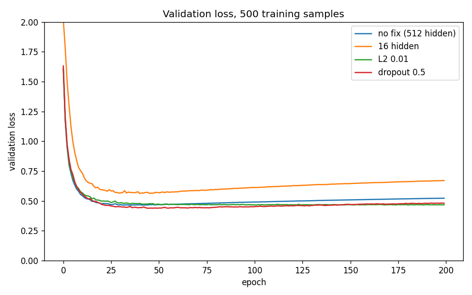

**What actually happened (honest reading).**
- Early stopping, L2 (0.01) and dropout (0.5) all **flatten the late rise in validation loss**, with dropout giving the best validation accuracy, but the accuracy gains are small (about 1 point).
- A smaller model did **not** help: 16 hidden neurons is still about 12,500 parameters, plenty to memorize 500 images, and it also learns slower and ends up slightly worse. Too strong L2 (0.05) starts to underfit (train accuracy drops below 100%).
- With only 500 examples, regularization can only do so much. **More data is what closes the gap:**

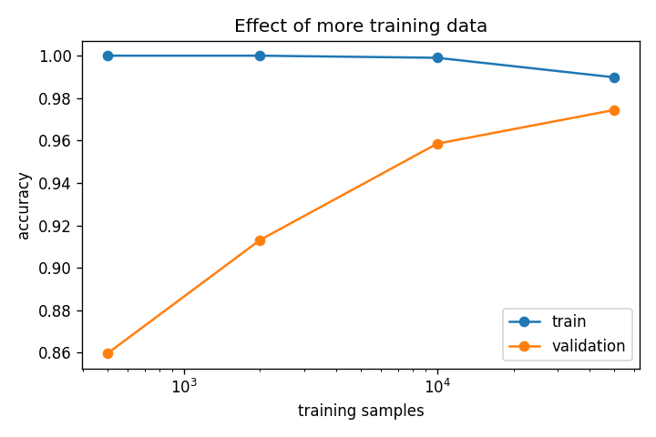

| Training samples | Train acc | Val acc | Gap |
|---|---|---|---|
| 500 | 100% | 86.0% | 14.0 pts |
| 2,000 | 100% | 91.3% | 8.7 pts |
| 10,000 | 99.9% | 95.9% | 4.0 pts |
| 50,000 | 99.0% | 97.4% | 1.5 pts |

> **Learning points**
> - **L2 weight decay** penalizes large weights, which favors smoother functions that depend less on any single pixel.
> - **Dropout** randomly silences hidden neurons during training, so no neuron can rely on a specific partner; it behaves like averaging many smaller networks. (Implemented as "inverted dropout", scaling the survivors so nothing changes at test time.)
> - **Early stopping** uses the validation curve to pick the epoch before the model starts memorizing.
> - Regularizers reduce the *symptoms* of too little data; they do not replace it. The train/validation gap shrinks steadily as the dataset grows.

### Learning rate

One epoch of training at five learning rates (128 hidden, 50k images):

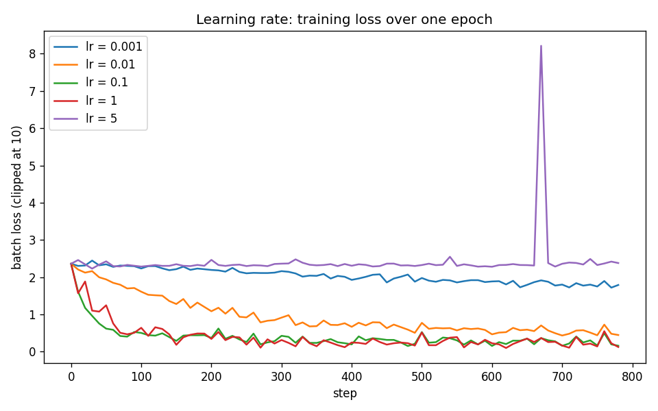

| lr | Val acc after 1 epoch | What happens |
|---|---|---|
| 0.001 | 57.5% | far too slow: loss only fell from 2.4 to 1.8 in 780 steps |
| 0.01 | 86.7% | learns, but slowly |
| **0.1** | **91.0%** | smooth and fast |
| 1.0 | 89.0% | fast but noisier |
| 5.0 | 10.5% | too high: steps overshoot, loss stays at chance level with a spike; nothing is learned |

> **Learning points**
> - Too low a learning rate wastes compute; too high a rate overshoots the minimum, so the loss bounces or never improves.
> - The best value is usually just below the point where training gets unstable.

---

## Stage 4: Distribution shift and data augmentation

A model that scores 97%+ on MNIST has only learned MNIST-style digits: centered, upright, with fairly uniform strokes. Real handwriting differs in rotation, position, size and pen thickness.

**Experiment A: a controlled stand-in for real-world shift.** I built a distorted copy of the validation set (rotations up to ±20°, shifts up to 3 px, rescaling, thicker/thinner strokes; fixed random seed) and trained two otherwise identical networks, one with augmentation (random rotation, shift, scale and stroke thickness applied to every training batch).

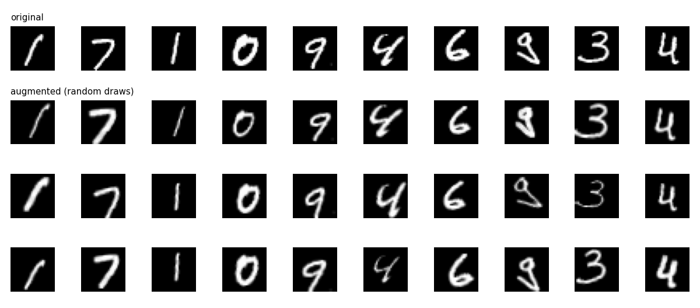

| Model | Clean validation | Distorted validation |
|---|---|---|
| Baseline | 97.4% | **57.4%** |
| With augmentation | 97.4% | **92.0%** |

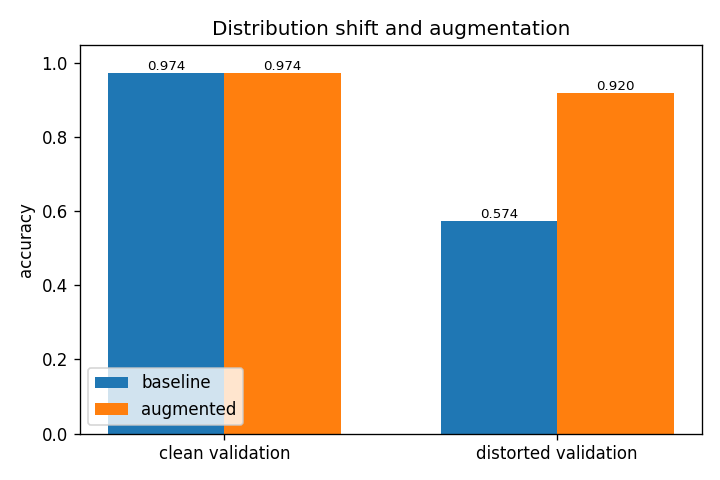

Final MNIST test-set accuracy (scored once, after all choices were made): **97.6%** baseline, **97.7%** augmented. Augmentation cost nothing on clean data and closed most of the shift gap.

> **Learning points**
> - Same-looking data is not same-distribution data. A model can be near-perfect on its benchmark and lose 40 points when the inputs shift slightly in ways it never saw.
> - Data augmentation is a way to *teach invariances* the training set lacks: "a rotated 7 is still a 7".
> - The test set measures generalization only to data drawn the same way as the training set, not to the real world.

**Experiment B: my own handwriting.**

I wrote 100 digits (10 per class) in a 10×10 grid with a marker, photographed the sheet, and processed it with [`preprocess_handwriting.py`](preprocess_handwriting.py): it finds the grid, flattens uneven lighting, then crops each digit, scales it to fit 20×20 and centers it by center of mass, which is how MNIST images were made. These 100 images are a **test set only**: never used for training, tuning, or choosing between models.

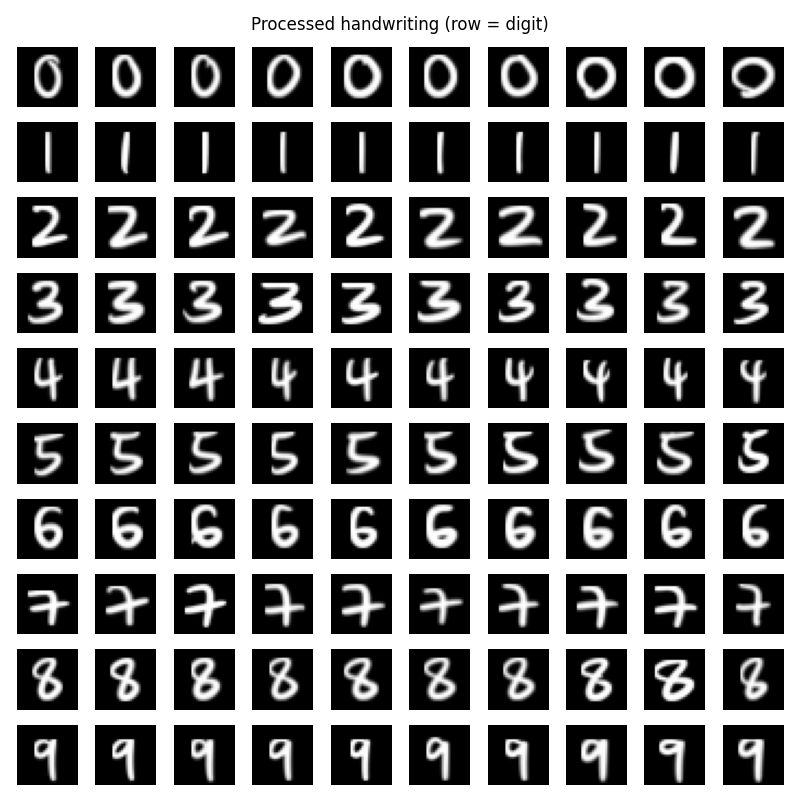

| Model | Accuracy on my handwriting |
|---|---|
| Baseline | 97% |
| With augmentation | 97% |

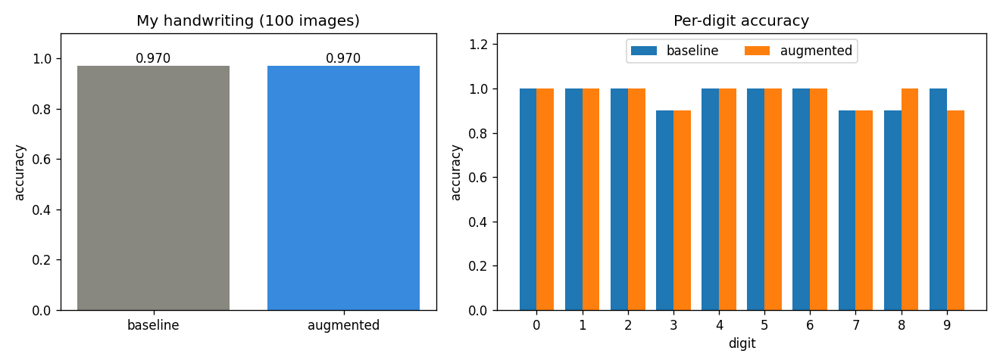

Each model made 3 mistakes (baseline: 3→2, 7→4, 8→3; augmented: 3→2, 7→2, 9→4). With only 100 images, the uncertainty is about ±3 points, so the two models are **not distinguishable** here, and I did not see the large gap that I had expected from the distorted-validation experiment.

**Why not? The preprocessing did most of the work.** MNIST-style centering and scaling remove the biggest differences between my writing and MNIST (position and size). To test this, I re-ran the same two models on the same sheet with a naive pipeline that just shrinks each whole grid cell to 28×28, leaving digits smaller and off-center:

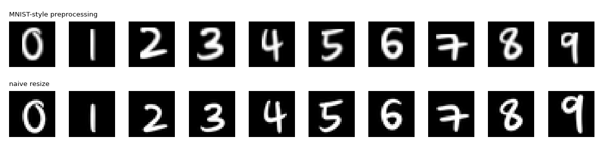

| Preprocessing | Baseline | Augmented |
|---|---|---|
| MNIST-style (crop, fit 20×20, center) | 97% | 97% |
| Naive resize of the whole cell | **71%** | **95%** |

The raw images are the same, but the baseline loses 26 points when the input stops looking like MNIST, and the augmented model barely notices. That is distribution shift in the wild: the model's 97–98% benchmark score only transfers to my handwriting if the inputs are first made to look like the training data, or if the model was trained to be robust to the differences.

Caveats: 100 images from one writer in a grid with a thick marker. It's also a small test set. The ablation compares preprocessing choices after seeing results, so treat it as an explanation, not a tuned result.

**A second, deliberately messy set.** To push harder, I wrote another 100 digits as sloppily as I could: slanted, with long tails, loops left open, and strokes running into the cell borders and into neighboring cells. Same pipeline, same models, no retraining.

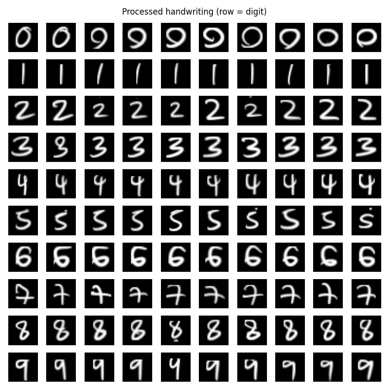

| Messy set | Baseline | Augmented |
|---|---|---|
| MNIST-style preprocessing | 92% | 92% |
| Naive resize of the whole cell | **50%** | **87%** |

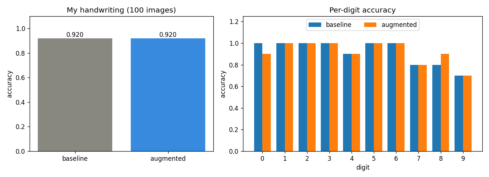

- **Accuracy fell about 5 points** compared with the neat set, and mistakes concentrate in the shapes that are genuinely confusable: 9s written with open loops read as 4 or 7, sloppy 7s read as 2 or 4, and 8s with broken loops read as 2 or 6.
- Some errors are **pipeline artifacts, not model failures**: where a tail crosses into the next cell, a stray dot appears in the digit below (visible in a few 2s and 5s), and long tails get clipped at the cell edge. My cell-splitting assumes each digit stays inside its box.
- Several of my "0"s are closed loops with a tail that look like 9s. The label is the row, so they were scored as 0s anyway.
- Both models again tie at 92%. With 100 images the uncertainty is about ±5 points, so the difference between models is not detectable here. The robust finding is the preprocessing ablation: **naive input costs the baseline 42 points but the augmented model only 5**.

> **Learning points**
> - "Looks the same to a human" isn't "looks the same to the model": a 7 shrunk and shifted inside a larger cell is still a 7 to us, but a different input to the network.
> - Deployment pipelines need the same preprocessing as training. A large part of real-world ML reliability is making inputs match the training distribution.
> - Augmentation makes the model robust to variation it will meet in practice instead of relying on perfectly normalized inputs.
> - Report surprising results honestly: the expected gap was small under good preprocessing, and the explanation (and its ablation) is the real finding.

---

## Summary: answers to the learning goals

1. **Overfitting.** The model fits its training data better than data it hasn't seen. It shows up as train loss falling while validation loss flattens and then rises (Stage 2). Fixes: more data (most effective), regularization, early stopping.
2. **Bias vs. variance, and the split.** Train is for fitting, validation is for decisions, test is for one final honest score. If you tune against the test set, it stops being an honest estimate.
3. **Regularization.** Smaller model, L2, dropout and early stopping each reduce overfitting in different ways. On 500 samples the effects were modest, and the experiments show they treat symptoms while more data treats the cause. A smaller model is not automatically better if it is still large relative to the data.
4. **Backpropagation and learning rate.** Gradients say how the loss changes if a weight is nudged, and I verified mine numerically. The learning rate is the step size: too small is slow, too large diverges or never learns.
5. **Distribution shift.** Accuracy dropped from 97.4% to 57.4% on distorted digits, and augmentation recovered it to 92.0%. On my own handwriting the model scored 97% (92% on a deliberately messy set) only after MNIST-style centering and scaling; without it the baseline fell to 71% (50% messy) while the augmented model held at 95% (87% messy). Benchmark accuracy only holds for data that looks like the training data.

---

## Project layout

```
data.py                    MNIST download/parsing and the 50k/10k/10k split
nn.py                      The network: forward, backward, loss, SGD (numpy only)
train.py                   Mini-batch training loop with L2, dropout, augmentation, early stopping
check_gradients.py         Backprop vs. finite-difference gradient check
explore_data.py            Dataset inspection and sample figure
experiments_small_data.py  Stages 2-3: overfitting, regularization, more data
experiment_lr.py           Stage 3: learning-rate sweep
augment.py                 Rotation / shift / scale / stroke-thickness augmentation
train_final_models.py      Stage 4: baseline vs. augmented training
preprocess_handwriting.py  Photo of handwriting sheet -> 28x28 MNIST-style images
final_eval.py              MNIST test (once) + handwriting evaluation
ablation_preprocessing.py  MNIST-style vs naive preprocessing on my handwriting
handwriting/               processed 28x28 digits (+ preview); raw photo kept local
figures/  results/  models/
```

## Reproducing

```bash
pip install -r requirements.txt
python3 explore_data.py             # downloads MNIST, saves sample figure
python3 check_gradients.py          # verifies backprop
python3 experiment_lr.py            # learning-rate sweep
python3 experiments_small_data.py   # Stages 2-3 (several minutes)
python3 train_final_models.py       # Stage 4 (several minutes)
python3 preprocess_handwriting.py handwriting/raw/sheet.jpg   # your own sheet (10x10 grid, row = digit)
python3 final_eval.py               # test set + handwriting (if handwriting/processed.npz exists)
python3 ablation_preprocessing.py   # naive vs MNIST-style preprocessing
# a second sheet, kept separate with a tag (here "messy"):
python3 preprocess_handwriting.py handwriting/raw/sheet_messy.jpg messy
python3 final_eval.py handwriting/processed_messy.npz messy
python3 ablation_preprocessing.py handwriting/raw/sheet_messy.jpg messy
```

Note: `nn.py` and `data.py` cap numpy's BLAS threads at 4. With default threading these small matrix products ran roughly 10x slower.

Everything uses fixed random seeds; results should reproduce closely.
